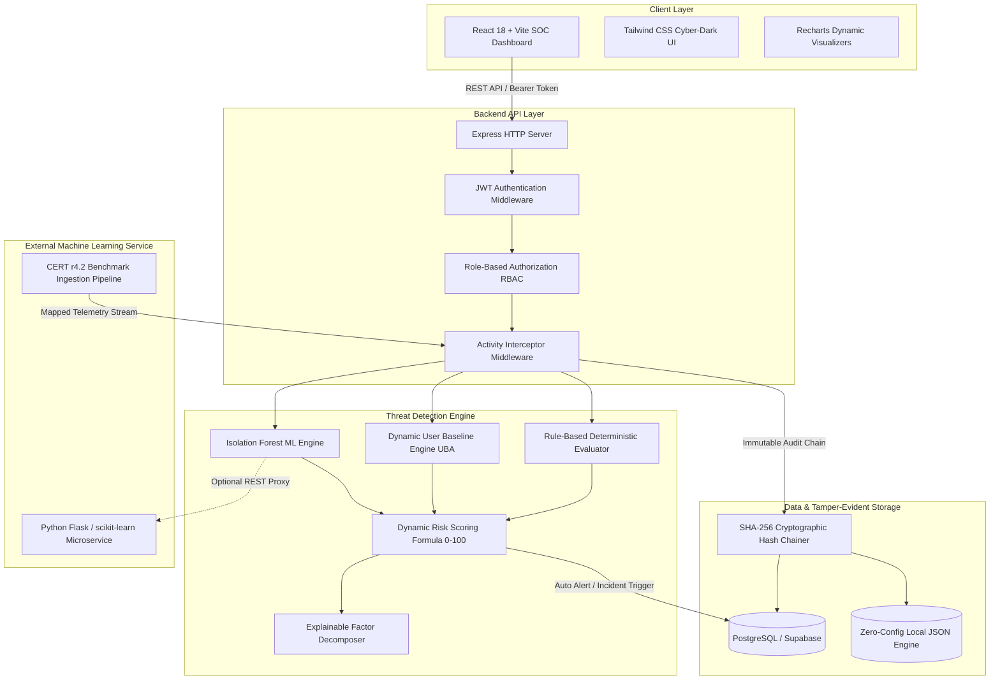

# System Architecture & Technical Specifications

## Project Title
**An Explainable Hybrid Framework for Insider Threat Detection Using User Behaviour Analytics and Dynamic Risk Scoring**

---

### 1. High-Level Architecture Diagram

---

### 2. Multi-Tier Layer Descriptions

#### Tier 1: Presentation (Security Operations Center UI)
- Built with **React 18**, **Vite**, **Tailwind CSS**, and **Lucide React**.
- Implements a modern SOC dark theme (`#090d16` canvas, cyan/emerald accents, glowing borders).
- Consists of 13 modular views satisfying all administrative, managerial, and employee requirements:
  1. Login & Authentication (`/login`)
  2. SOC Overview Dashboard (`/`)
  3. Live Activity Stream (`/activity`)
  4. Security Alerts & Triage Center (`/alerts`)
  5. Incident Case Files (`/incidents`)
  6. Monitored User Directory (`/users`)
  7. User Behavioral Threat Dossier (`/risk-profile`)
  8. Behavioral Baseline Comparison (`/baselines`)
  9. Detection Rule Lab (`/rules`)
  10. Tamper-Evident Audit Verification (`/audit`)
  11. Reports & MITRE ATT&CK Matrix (`/reports`)
  12. Research Evaluation & Model Performance (`/research`)
  13. Threat Simulations & CERT Import (`/simulation`)

#### Tier 2: Application Programming Interface (Node.js & Express)
- Handles user authentication, token issuance (JWT), role-based authorization (Administrator, Manager, Employee), and request interception.
- Restricts Employees from accessing administrative endpoints or other personnel records on the server.

#### Tier 3: Hybrid Threat Detection Engine
Combines three complementary detection paradigms:
1. **Rule-Based Engine ($S_{rule} \in [0, 100]$):** Evaluates rapid brute-force logins, mass downloads, unauthorized probing, off-hours access, and modification spikes.
2. **Behavior-Based Anomaly Engine ($S_{ml} \in [0, 100]$):** Pure JavaScript Isolation Forest with boundary isolation + optional Python scikit-learn microservice.
3. **Dynamic User Baseline Engine ($S_{base} \in [0, 100]$):** Computes rolling mean and standard deviation ($\mu, \sigma$) across daily downloads, modifications, unique resources, and operational hours. Calculates Z-score deviations ($Z = \frac{x - \mu}{\sigma}$).

**Explainable Dynamic Risk Score Formula:**
$$\text{Risk Score} = \min\left(100, \; 0.45 \cdot S_{rule} + 0.30 \cdot S_{ml} + 0.25 \cdot S_{base}\right)$$

#### Tier 4: Tamper-Evident Audit Logging (SHA-256 Hash Chaining)
- Every significant operational event and threat detection is cryptographically chained into an append-only ledger:
  $$H_n = \text{SHA256}\left(H_{n-1} \mathbin{\Vert} \text{Payload} \mathbin{\Vert} \text{Salt}\right)$$
- An automated one-click integrity verification utility traverses the chain sequentially ($n = 1 \dots N$), verifying sequence continuity, link validity, and payload hash matching.
